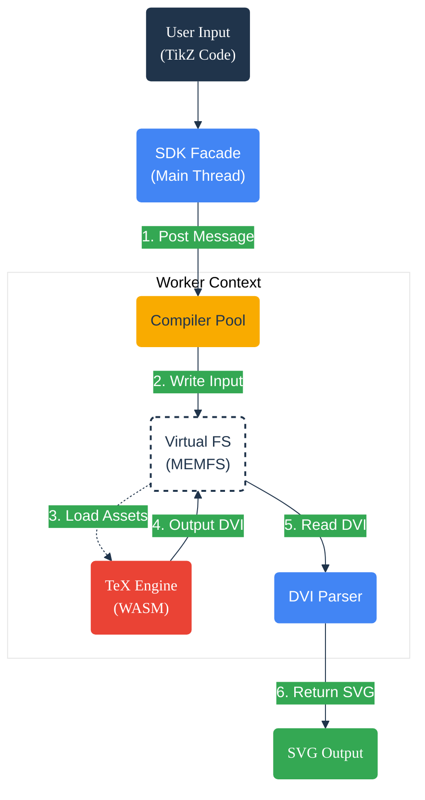

TikZ WASM
=========
[](https://opensource.org/licenses/Apache-2.0)

A specialized, dependency-free TypeScript library for compiling LaTeX TikZ graphics directly in the browser via
WebAssembly.

This project creates a bridge between a headless, Emscripten-compiled TeX engine (`pdftex`) and a modern JavaScript
environment. It utilizes a custom memory dump (`tikz.fmt`) to pre-load the TikZ/PGF environement, significantly reducing
boot times compared to raw LaTeX compilation.

## Architecture

The system operates by instantiating a Web Worker containing the WASM binary. User input is wrapped in a standalone
document template, processed by the TeX engine into a DVI (DeVice Independent) stream, and parsed into SVG.



## Features

* **Zero-Backend**: Runs entirely client-side.
* **Performance**: Utilizes `tikz.fmt` to skip TeX package loading times.
* **Dependency Free**: The final bundle inlines the WASM and Format binaries (Gzipped & Base64 encoded) requiring no
  external asset fetching at runtime.
* **Type Safety**: Written in strict TypeScript.
* **Dvisvgm Compatible**: Parses specific geometry specials produced by the `dvisvgm` driver for accurate SVG paths.

## Usage

### Installation

```bash
npm install tikz-wasm
```

### Basic Implementation

```typescript
import { initTikz, renderTikzAsSvg } from 'tikz-wasm';

// 1. Initialize (Unpacks WASM/FMT from bundle)
await initTikz();

// 2. Render
try {
    const svg = await renderTikzAsSvg(`
    \\begin{tikzpicture}
      \\draw[fill=red!20] (0,0) circle (1cm);
    \\end{tikzpicture}
  `);

    document.body.innerHTML = svg;
} catch (err) {
    console.error("Compilation failed", err);
}
```

## Development & Building

This project requires a complex build chain because it must generate the binary format file (`tikz.fmt`) derived from a
local TeX installation before bundling the JavaScript.

### Prerequisites

1. **Node.js 20+**
2. **TeX Live Distribution**: The build scripts require `kpsewhich` and a standard TeX directory structure to locate
   PGF/TikZ macros during the asset generation phase.

### Build Steps

1. **Install Dependencies**
   ```bash
   npm install
   ```

2. **Asset Setup & Patching**
   Download the upstream `pdftex` WASM binary and patch the Emscripten glue code.
   ```bash
   npx tsx scripts/setup.ts
   ```

3. **Generate Format File (`tikz.fmt`)**
   This step runs the WASM engine in "INI" mode, mounting your local machine's TeX files into the WASM VFS to compile
   the format file.

   *Replace `<PATH_TO_TEXMF_DIST>` with your local path (e.g., `/usr/share/texlive/texmf-dist` on Linux
   or `/opt/homebrew/share/texmf-dist` on macOS).*
   ```bash
   npx tsx scripts/build_fmt.ts <PATH_TO_TEXMF_DIST>
   ```

4. **Bundle**
   Compiles TypeScript and inlines the assets into the final bundle using Vite.
   ```bash
   npm run build
   ```

## Testing

The project uses **Vitest** for unit and integration testing.

```bash
# Run all tests
npm test

# View coverage
npm run test -- --coverage
```

### Coverage Report

The project maintains high test coverage (~90%) across core logic:

* **Bridge/Generator**: Low usage of mocks ensures real WASM interaction logic is tested.
* **DVI Parser**: Verified against real binary outputs for opcodes and specials.
* **SVG Builder**: Validated for coordinate precision and bounding box calculations.

## Continuous Integration (CI)

The CI pipeline is defined in `.github/workflows/`. It replicates the local build process within a runner environment.

### Workflow: `release.yml`

This workflow runs on Git tags (`v*`) and handles the full production release cycle:

1. **Environment Setup**: Spins up an `ubuntu-latest` runner.
2. **System Dependencies**:
    * Installs `texlive-latex-base`, `texlive-pictures`, and `texlive-latex-extra` via `apt-get`.
    * This provides the necessary PGF/TikZ files (`/usr/share/texlive/texmf-dist`) that the WASM builder needs to read.
3. **Asset Generation**:
    * Runs `scripts/setup.ts` to fetch upstream artifacts.
    * Detects the TeX Root using `kpsewhich -var-value=TEXMFDIST`.
    * Runs `scripts/build_fmt.ts` passing the detected root to generate `src/assets/tikz.fmt`.
4. **Verification**: Runs the full test suite against the generated assets.
5. **Bundling**: Vite inlines the ~10MB (raw) / ~3MB (gzipped) assets into the JS bundle.
6. **Publication**: Publishes the package to NPM and creates a GitHub Release with the binary artifacts attached.

---

## License

Licensed under either of

- Apache License, Version 2.0 ([LICENSE-APACHE](LICENSE-APACHE) or <https://apache.org/licenses/LICENSE-2.0>)
- MIT license ([LICENSE-MIT](LICENSE-MIT) or <https://opensource.org/licenses/MIT>)

at your option.

### Contribution

Unless you explicitly state otherwise, any contribution intentionally submitted
for inclusion in the work by you, as defined in the Apache-2.0 license, shall be
dual licensed as above, without any additional terms or conditions
